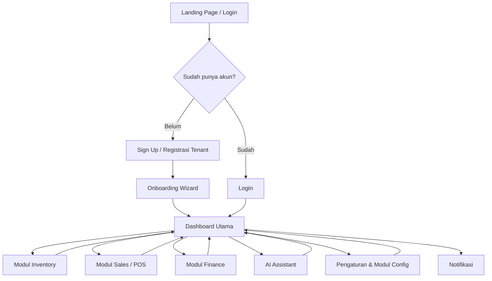
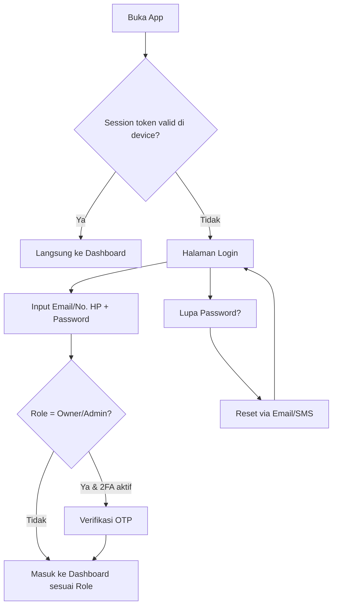
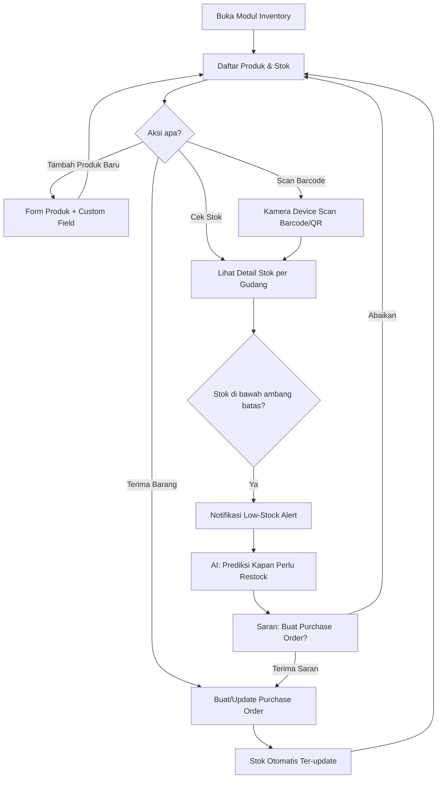
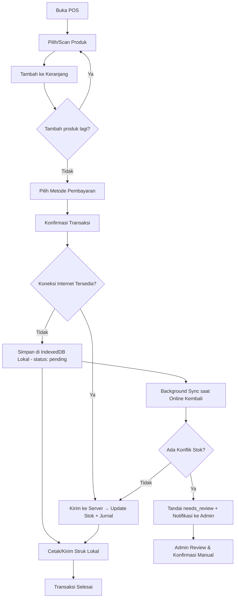
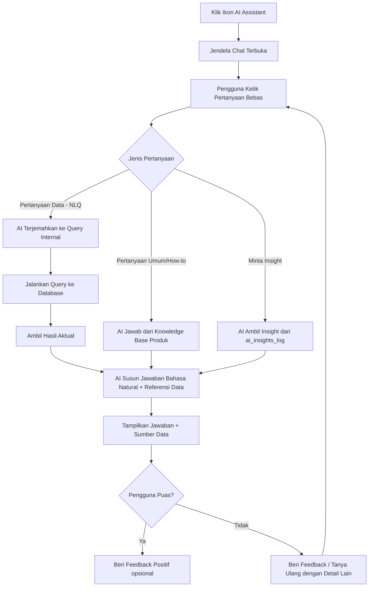
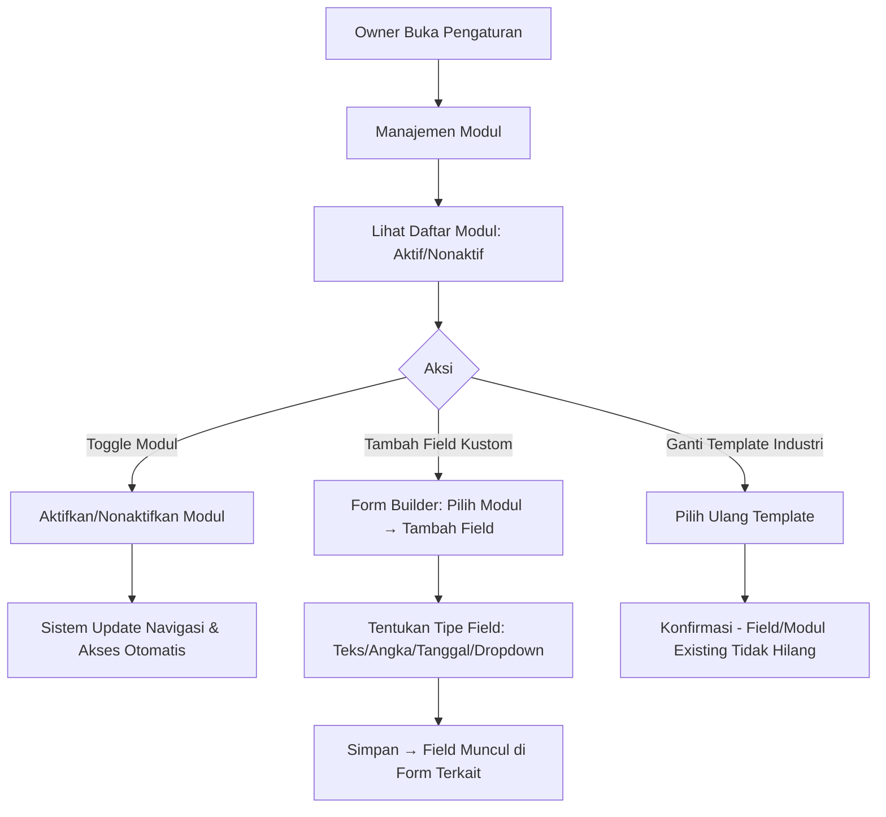
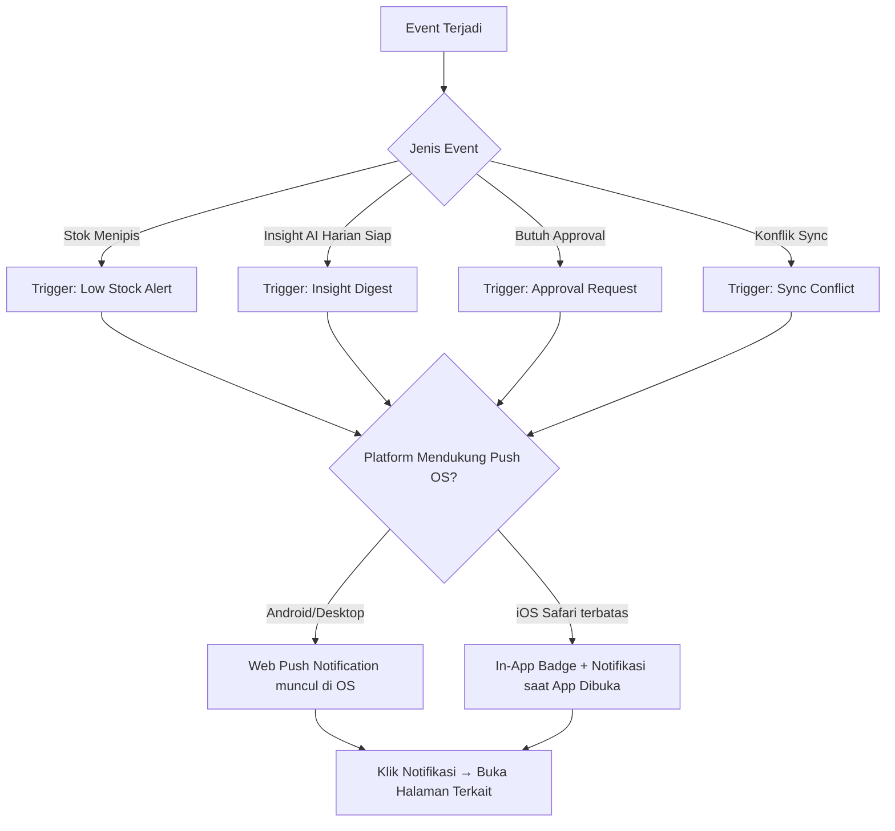
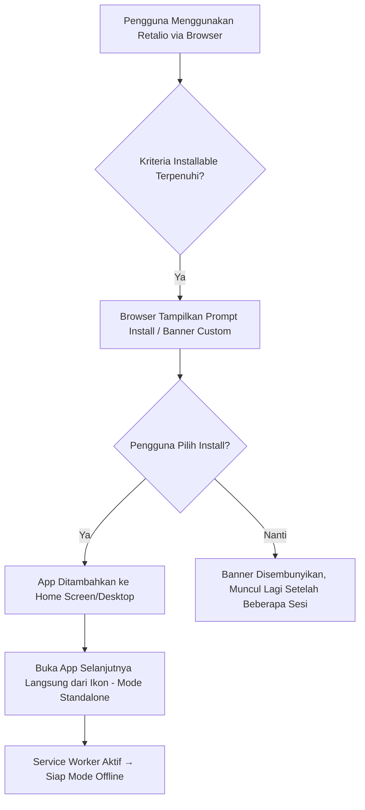
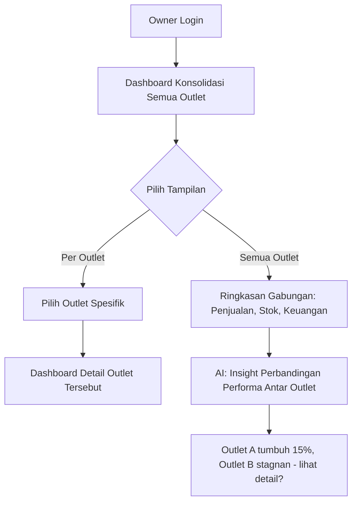

# App Flow Document
# Retalio — Smart Business System (SBS)

| | |
|---|---|
| **Nama Produk** | Retalio |
| **Versi Dokumen** | 1.0 |
| **Tanggal** | 6 September 2026 |
| **Platform** | Progressive Web App (PWA) |
| **Dokumen Terkait** | PRD_Retalio_SBS.md, TRD_Retalio_SBS.md, Database_Schema_Retalio_SBS.md |

---

## 1. Ringkasan

Dokumen ini menjabarkan **alur penggunaan (user flow)** aplikasi Retalio dari sisi pengguna — mulai dari onboarding awal, navigasi utama, hingga alur kerja detail di setiap modul (Inventory, POS, Finance, AI Assistant), termasuk perilaku khusus PWA seperti install & mode offline.

---

## 2. Peta Alur Level Tinggi (High-Level App Map)



---

## 3. Alur Onboarding (First-Time User)

```mermaid
flowchart TD
    A[Buka Retalio via Browser] --> B[Klik "Daftar Bisnis Baru"]
    B --> C[Isi Data Bisnis: Nama, Industri]
    C --> D{Pilih Template Industri}
    D -->|Retail| E1[Preset modul: Inventory, POS, Finance]
    D -->|Manufaktur| E2[Preset modul: Inventory, Produksi, Finance]
    D -->|Jasa| E3[Preset modul: Booking, POS, Finance]
    E1 --> F[Setup Outlet Pertama]
    E2 --> F
    E3 --> F
    F --> G[Undang/Buat Akun Staff opsional]
    G --> H[Tambah Produk/Jasa Pertama]
    H --> I[Prompt: Install Retalio sebagai App? Add to Home Screen]
    I --> J[Tour Singkat Fitur Utama - termasuk AI Assistant]
    J --> K[Dashboard Utama Siap Dipakai]
```

**Catatan UX:**
- Setiap langkah bisa di-skip dan dilanjutkan nanti (kecuali nama bisnis & pemilihan template industri).
- Target: pengguna bisa mencapai transaksi POS pertama dalam < 30 menit.
- Prompt install PWA ditampilkan secara halus (non-intrusive banner), tidak memblokir alur.

---

## 4. Alur Login & Autentikasi



Tampilan dashboard menyesuaikan **role** pengguna:
- **Owner/Admin** → Dashboard lengkap (semua modul + insight AI + laporan keuangan).
- **Manager** → Dashboard operasional (inventory, sales report per outlet).
- **Kasir/Staff** → Langsung ke antarmuka POS, tanpa akses laporan keuangan.

---

## 5. Alur Modul: Smart Inventory Control



**Poin Penting:**
- Notifikasi low-stock dikirim via push notification (atau in-app badge di iOS).
- Rekomendasi AI selalu punya tombol **"Buat PO Otomatis"** dan **"Abaikan"** — tidak pernah mengeksekusi pembelian tanpa konfirmasi.

---

## 6. Alur Modul: Sales & POS (termasuk Mode Offline)



**Poin Penting (khusus PWA):**
- Transaksi offline tetap bisa dicetak/ditampilkan struknya secara lokal.
- Sinkronisasi berjalan otomatis di background begitu koneksi kembali — kasir tidak perlu melakukan apa pun secara manual.
- Jika terjadi konflik (misal produk yang sama terjual di 2 device saat offline), transaksi **tidak dibatalkan otomatis**, tapi ditandai untuk direview admin.

---

## 7. Alur Modul: Real-Time Financial Reporting

```mermaid
flowchart TD
    A[Buka Modul Finance] --> B[Dashboard Keuangan]
    B --> C{Pilih Laporan}
    C -->|Laba Rugi| D[Tampilkan P&L Real-time]
    C -->|Arus Kas| E[Tampilkan Cashflow Aktual]
    C -->|Prediksi Arus Kas AI| F[AI Cashflow Forecast 30/60/90 hari]
    C -->|Cek Anomali| G[Daftar Transaksi Ditandai Anomali]

    G --> H[Lihat Detail + Alasan AI Menandai]
    H --> I{Valid sebagai kesalahan/fraud?}
    I -->|Ya| J[Eskalasi ke Owner/Investigasi]
    I -->|Tidak, false positive| K[Tandai "Bukan Anomali" - feedback ke AI]

    B --> L[Export Laporan PDF/Excel]
```

**Poin Penting:**
- Semua laporan berbasis data real-time dari `financial_entries` (jurnal otomatis).
- Feedback pengguna terhadap flag anomali (§7) tersimpan untuk evaluasi & penyempurnaan model deteksi ke depannya.

---

## 8. Alur AI Business Assistant



**Poin Penting:**
- Jawaban numerik AI **selalu diambil dari query database aktual**, bukan dikira-kira oleh model — mencegah halusinasi angka.
- Setiap jawaban menyertakan referensi sumber data agar pengguna bisa verifikasi.
- Jika tidak ada koneksi internet, Assistant menampilkan pesan bahwa fitur ini butuh koneksi (bukan silent fail).

---

## 9. Alur: Modular Customization (Toggle & Custom Field)



**Poin Penting:**
- Toggle modul **tidak menghapus data** — hanya menyembunyikan akses/navigasi.
- Penambahan custom field tidak butuh developer/downtime (sesuai prinsip low-code).

---

## 10. Alur Notifikasi & Push (PWA)



---

## 11. Alur Install PWA (Add to Home Screen)



---

## 12. Alur Multi-Outlet (Manajemen Lintas Cabang)



---

## 13. Ringkasan Peran vs Akses Flow

| Role | Flow yang Diakses |
|---|---|
| **Owner** | Semua flow (§3–§12) termasuk konfigurasi modul & laporan keuangan |
| **Admin** | Semua flow operasional + konfigurasi modul (tanpa data finansial sensitif tertentu, sesuai kebijakan) |
| **Manager** | Inventory, Sales report, AI insight per outlet — tanpa akses toggle modul |
| **Kasir** | Hanya flow POS (§6) + notifikasi terbatas |
| **Staff** | Sesuai permission granular yang diberikan admin |

---

## 14. Referensi

- Kebutuhan produk & fitur: `PRD_Retalio_SBS.md`
- Spesifikasi teknis & arsitektur PWA/AI: `TRD_Retalio_SBS.md`
- Struktur data pendukung setiap flow: `Database_Schema_Retalio_SBS.md`

---

*Dokumen ini akan diperbarui seiring hasil usability testing dan penambahan modul baru (mis. flow Payroll/HR di Fase 2).*
