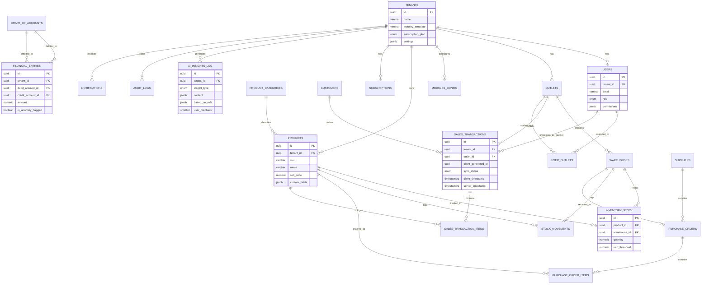

# Database Schema Document
# Retalio — Smart Business System (SBS)

| | |
|---|---|
| **Nama Produk** | Retalio |
| **Versi Dokumen** | 1.0 |
| **Tanggal** | 6 September 2026 |
| **Database Engine** | PostgreSQL 15+ |
| **Strategi Multi-tenant** | Shared database, shared schema + `tenant_id` (isolasi via Row-Level Security) |
| **Dokumen Terkait** | PRD_Retalio_SBS.md, TRD_Retalio_SBS.md |

---

## 1. Ringkasan

Dokumen ini menjelaskan struktur database Retalio SBS: entitas, relasi antar tabel, tipe data kunci, serta strategi khusus untuk **multi-tenancy**, **custom field (low-code)**, dan **sinkronisasi offline PWA**. File DDL lengkap tersedia terpisah di `retalio_schema.sql`.

### 1.1 Prinsip Desain
- Setiap tabel operasional membawa kolom `tenant_id` untuk isolasi data antar bisnis.
- Field kustom per tenant disimpan sebagai `JSONB` (`custom_fields`) agar tidak perlu migrasi skema saat bisnis menambah atribut sendiri.
- Transaksi POS didesain **offline-first**: menyimpan `client_generated_id` dan dua timestamp (`client_timestamp` & `server_timestamp`) plus status sinkronisasi.
- Semua insight AI dicatat dengan referensi data sumber (`based_on_refs`) agar rekomendasi bersifat *explainable*.

---

## 2. Diagram Entity-Relationship (ERD)

---

## 3. Daftar Tabel & Deskripsi

### 3.1 Platform / Global

| Tabel | Deskripsi |
|---|---|
| `tenants` | Data induk setiap bisnis (nama, industri, plan, pengaturan) |
| `subscriptions` | Riwayat & status langganan per tenant, termasuk kuota AI bulanan |
| `modules_catalog` | Daftar master semua modul yang tersedia di platform |

### 3.2 Konfigurasi Tenant

| Tabel | Deskripsi |
|---|---|
| `modules_config` | Modul yang aktif per tenant + custom field & workflow (low-code) |

### 3.3 User & Akses

| Tabel | Deskripsi |
|---|---|
| `users` | Akun pengguna per tenant, dengan role (`owner`, `admin`, `manager`, `cashier`, `staff`) |
| `outlets` | Cabang/toko fisik milik tenant |
| `user_outlets` | Relasi many-to-many: user bertugas di outlet mana saja |

### 3.4 Smart Inventory Control

| Tabel | Deskripsi |
|---|---|
| `product_categories` | Kategori produk (mendukung hierarki via `parent_id`) |
| `suppliers` | Data pemasok |
| `products` | Master produk, termasuk `custom_fields` untuk atribut khusus per bisnis |
| `warehouses` | Gudang/lokasi penyimpanan stok, bisa menempel ke outlet |
| `inventory_stock` | Jumlah stok real-time per produk per gudang + `min_threshold` |
| `stock_movements` | Log setiap pergerakan stok (jual/beli/adjustment/produksi) — sumber data AI forecasting |
| `purchase_orders` / `purchase_order_items` | Pemesanan pembelian ke supplier |

### 3.5 Sales & POS

| Tabel | Deskripsi |
|---|---|
| `customers` | Data pelanggan + poin loyalitas |
| `sales_transactions` | Transaksi penjualan, **offline-aware** (lihat §4) |
| `sales_transaction_items` | Rincian item per transaksi |

### 3.6 Financial Reporting

| Tabel | Deskripsi |
|---|---|
| `chart_of_accounts` | Daftar akun akuntansi (asset/liability/equity/revenue/expense) |
| `financial_entries` | Jurnal otomatis dari setiap transaksi operasional, dengan flag anomali |

### 3.7 AI — Retalio Intelligence

| Tabel | Deskripsi |
|---|---|
| `ai_insights_log` | Semua output AI (prediksi, insight, chat, OCR) + referensi sumber data & feedback pengguna |
| `ai_usage_counters` | Penghitung pemakaian AI per tenant per bulan (rate limit & billing) |

### 3.8 Audit & Notifikasi

| Tabel | Deskripsi |
|---|---|
| `audit_logs` | Jejak audit setiap perubahan data penting (before/after) |
| `notifications` | Notifikasi ke pengguna (stok menipis, insight AI, approval, konflik sync) |

---

## 4. Desain Khusus: Sinkronisasi Offline (PWA)

Tabel `sales_transactions` dirancang agar transaksi tetap bisa dicatat saat perangkat offline:

| Kolom | Fungsi |
|---|---|
| `client_generated_id` | UUID dibuat di device saat transaksi terjadi (sebelum ada koneksi ke server) |
| `client_timestamp` | Waktu transaksi sebenarnya terjadi di kasir |
| `server_timestamp` | Waktu data diterima & disimpan server |
| `sync_status` | `pending` → `synced`, atau `conflict` / `needs_review` jika ada bentrok data (mis. stok sudah berubah di tempat lain) |

> Konflik **tidak pernah otomatis ditolak** — transaksi ditandai `needs_review` agar admin bisa memverifikasi, sehingga data penjualan tidak hilang.

---

## 5. Desain Khusus: Custom Field (Low-Code)

Beberapa tabel memiliki kolom `custom_fields JSONB` (mis. `products`, `modules_config`) sehingga tenant dapat menambahkan atribut sendiri (misalnya "Ukuran", "Warna", "Tanggal Kedaluwarsa" untuk Retail, atau "Nomor Batch Produksi" untuk Manufaktur) **tanpa migrasi database**. Index GIN ditambahkan di kolom ini agar tetap bisa di-query secara efisien.

---

## 6. Desain Khusus: Isolasi Multi-Tenant

- Semua tabel operasional memiliki `tenant_id`.
- Diterapkan **Row-Level Security (RLS)** di PostgreSQL: aplikasi wajib menetapkan `app.current_tenant_id` di setiap sesi/transaksi sebelum query berjalan, sehingga satu tenant tidak bisa mengakses data tenant lain meski terjadi bug di level aplikasi (defense in depth).

---

## 7. Desain Khusus: AI Explainability

Tabel `ai_insights_log` menyimpan:
- `content` — isi insight yang ditampilkan ke pengguna,
- `based_on_refs` — referensi ID data mentah yang mendasari insight (mis. daftar `stock_movements.id` yang dipakai untuk prediksi restock),
- `user_feedback` — umpan balik pengguna (berguna/tidak) untuk evaluasi kualitas model dari waktu ke waktu.

---

## 8. Referensi

- DDL lengkap (siap dieksekusi): `retalio_schema.sql`
- Spesifikasi teknis lengkap: `TRD_Retalio_SBS.md` (§5 Model Data, §6 PWA, §7 Integrasi AI)
- Kebutuhan produk: `PRD_Retalio_SBS.md`

---

*Dokumen ini akan diperbarui seiring perubahan skema saat development berjalan (mis. tabel baru untuk modul HR/Payroll di Fase 2).*
